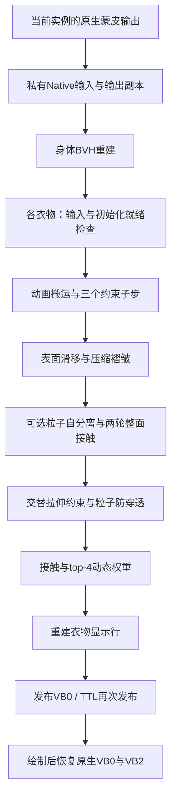

# 拖拽穿脱实验与历史验证

以下记录包含已撤回的方案和旧调度。当前配置、计算流程与限制以[使用说明](drag-cloth.md)为准。

# 拖拽碰撞与上下穿脱：配置、计算流程和检查

## 节点配置

拖拽交互节点的功能开关中：

| 开关 | 生成内容 | 关闭行为 |
|---|---|---|
| 启用碰撞检测 | 普通拉扯的当前帧身体 BVH 与整面位移约束 | 不生成普通碰撞段族 |
| 启用上下拖拽 | 衣物代理、贴身穿脱、连续褶皱、动态接触权重和独立热键 | 不生成穿脱段族，并清理其自有旧资源 |

两项可分别启用。穿脱本身需要身体表面约束，不依赖普通碰撞开关。
穿脱参数中的“衣物自碰撞”默认关闭，只控制衣物粒子之间的自分离；身体碰撞继续保留。

### 人体分区与连续表面行程（2026-11-14）

有可对应的人体参考骨架和穿脱箭头时，生成器从初始骨架层级与蒙皮取得三个大区：
躯干及双腿、左臂、右臂。区域由起点所在大区绑定；躯干衣片不吸附或排斥手臂，袖管
也不转贴躯干或另一只手臂。分区不随游戏动画、两面距离或法线改变。
连裤袜的连通同步、短裤双腿过渡和两只独立袜子的各自腿通道保持独立于这个大区划分。

上衣和袖管在选定分区的初始皮肤网格上生成连续的表面行程坐标，沿其梯度和三角面
邻接推进。胸部凸起或手肘弯曲属于同一分支的几何起伏，不按表面法线角度截断；
本分支的边界不会因另一人体部位靠近而连接起来。此坐标每个顶点只有一个标量，
不保存预制穿脱姿态或按档位切换网格。身体动画通过原生 SO 上的当前三角面插值输送。

参考身体分区的切口生成定向封口，只用于可靠的体内判定；封口不作为吸附或排斥表面，
也不增加或修改渲染身体。衣物目标位置、身体排斥和骨骼接触分别保存，不用世界平面
截断骨骼变形后的曲面。口沿同样参与拉伸约束，以软牵引代替逐点硬定位。
拉伸上限约束与弹性投影不叠加过冲，避免边端点互相越过。
保留的其他分支衣片使用其初始身体三角面的重心绑定和原间隙随骨骼移动，不再把
游戏匹配后的衣物蒙皮位置当成身体接触点，避免腋下跨分支连接处被两套蒙皮拉开。

连续表面模式在求解后验证顶点体内状态、完整三角面相交和严重拉伸；几何合格且松手、
目标与身体姿态稳定时保留当前形状，仅执行骨骼跟随和发布。存在未解决的几何问题时
继续求解，不能依靠超时认定收敛。3毫米是当前测试工程的贴合设置，间隙参数仍以毫米显示。
材料伸长以绑定形态的长度及当前整体缩放计算；蒙皮姿态压短的边另外报告，不能把
恢复其原长度误判为布料拉长。检测到超限时，仅补做材料/接触修复，合格的结果跳过补算。

闭合人体分区保留原有材料约束轮数。前两轮执行完整接触搜索，后续各轮先检查实际
顶点和三角面，仅对已合格的几何跳过重复碰撞搜索，材料求解仍继续。末段接触修正和
最多四轮补算保持不变，未解决的问题继续阻止休眠。没有几何验证的旧路径保留原流程。
基础轮次同时求各面的接触修正，再按顶点邻接收集平均修正并限制其扫掠路径；每个面角
使用独立槽，避免多个面并发写同一顶点。末段和补算继续采用着色后的顺序约束，修复
单纯并行平均在极限行程留下的局部拉伸。所有衣物和实例槽的临时修正缓冲分别分配。
质量结果由64个线程并行汇总，每件衣物、每个实例槽单独保存；
下一帧读取该结果，稳定跟随与已经合格的补算阶段不再重复扫描整个质量数组。

2026-11-14 的同机 RTX 4070 抓帧回放中，三个区域对应上衣、短裤、左右袜四组。
整段GPU时间中位数：只继续拖上衣约184.5→60.0毫秒，全部半脱后保持约21.5→11.6毫秒，
三个目标同时变化的压力测试约737.3→424.6毫秒。派发832→608次。时间戳覆盖实际生成的
命令列表，不含编译、CPU提交和读回，也不是游戏端到端输入延迟；三个目标同时变化仍偏重。
正式导出的产物通过40步正向/40步回拉、组合独立控制、逐字节原生复位和六项独立网格检查。

下文保留早期实验说明；涉及全身体阻挡、按轴向高度截面搜索和强制静置的描述是旧路径。
无可用人体参考骨架时保留原几何识别及腿归属回退，不据此声明任意无骨架上衣均通过验收。

1. 使用 ZZMI 合并骨架导出，并将拖拽交互节点接入结果输出的后处理链。
   删除物体注释的后处理应放在本节点之后，选择衣物与碰撞体需要这些注释。
2. 配置目标 DrawIB 和有效拖拽区域。
3. 开启“启用上下拖拽”。各区域的包含物体就是该区域的衣物，碰撞体就是身体，
   不再设置节点级衣物/身体集合。两者都必须能命中同一合并载体中的实际导出面。
   身体表面必须连续覆盖袜口至最低位置；只选大腿时，应相应提高最低高度比例。
4. 连通的连裤袜共享一个穿脱目标；拓扑分开的袜子分别控制。无关身体网格不参与衣物形变。
   区域参数中的“穿脱方向”可设为默认、沿衣物轴负向或正向。负向控制上开口向下收拢，
   正向控制下开口向上收拢。一个区域也可以单独使用任一方向，两个区域可以分别控制两端。
   反向拖动会展开当前抓取的一端。双端模式需要两个独立开口，默认保留5%的材料长度，
   可通过“双端最小保留长度”调整。两端收拢到极限后继续拖动，会带着压缩的衣物一起移动。
5. 导出后默认通过 **Ctrl+Alt+U** 开启穿脱；可在节点设置运行时默认开启与快捷键。
   沿原抓取操作上下拖动，松手保留目标位置；**Ctrl+Alt+Backspace** 恢复原穿着位置。
   F10 后的首次拖动不需要预先手动复位。

### 用箭头明确设置方向与行程

展开区域，点击“创建/显示箭头”。视口和 Outliner 的 `SSMT_穿脱行程` 集合中会出现
“穿脱起点”和“穿脱端点”两个空物体。起点显示为箭头，端点显示为小球；箭头的朝向
与长度始终连接两点。使用“选起点”/“选端点”按钮或直接在视口选中，按 **G** 移动。

- 起点放在要拉动的衣物开口平面附近。
- 端点放在该开口最多能到达的位置。例如上衣下摆上拉，只把端点放到腋下/袖口下方。
- 箭头方向和长度决定生成后的移动轴与最大行程，优先于自动方向；反向拖动可返回起点。
- 修改两点后重新导出，游戏 F10 重载。箭头是编辑辅助，不参与模型导出。

初次创建会按当前衣物与区域位置给出建议，用户可移动两点覆盖建议，不必依赖袖口限位识别。
目标端点参与实时连续计算，不生成预制档位。接触约束仍保留身体表面的安全间隙。
旧几何回退路径按开口横向范围收窄候选；人体分区路径则只使用起点所属大区的皮肤表面。
袜子保留固定腿归属，不因配置箭头而取消左右腿区分。
箭头模式在行程带内从原始接触面沿身体邻接关系扩散，排除空间接近但不连通的手臂片区。
每个代理点保存初始身体面和几何径向。运行时先沿上次接触的邻接面推进，再按材料目标
高度在同一贴合片区内查找；使用绑定几何的截线插值到当前动画表面，避免在大凸起或
三角形顶点处停滞。不因附近出现更近的表面而改贴另一身体部位。遮挡与身体自接触只影响碰撞阻挡，
不改变已确定的贴合归属。袜子归属覆盖对应腿的完整周面，不用衣物高度裁剪腿的横向半径。
裤装的横向轴优先取身体两脚的分离方向，避免将前后裤片误判为左右腿。裤裆中间的布面
允许跨在两腿之间，过渡位置由当前左右腿的表面插值获得，不强制贴到一条腿的内侧。
衣口支撑轮廓按原衣口的周长比例重新采样，避免胸前或两腿之间的长边集中到少数顶点上。
同一连通衣物使用多个箭头时要求同轴，可分别控制两端；不同衣物的箭头可设置不同轴。
分叉衣物的非移动部分按材料轴锚定。这个约束仍是贴身穿脱近似，弯曲袖筒的曲线路径和
复杂接缝处的真实应力并未由直线箭头描述。清空两点引用后恢复原来的自动/正负方向模式。

多个区域包含不同衣物时，各自生成代理、目标、接触和权重状态。同一衣物的多个区域
可控制两端，须使用相同碰撞体；相同身体面集合复用 BVH，不共享衣物状态。一个袜子
物体包含两只不连通的袜子时，生成两个独立运行时，抓中哪只就操作哪只。

区域权重控制普通拖拽的命中范围与强度；在穿脱中用于确定抓中了哪个控制区域。
衣物模拟范围来自包含物体，袖口固定区来自衣物开口与拓扑，不把区域权重当作布料
固定权重。修改箭头终点也不应改变上衣的袖口固定区。

未配置箭头时，有分叉衣物采用保守的拓扑分类：有下摆、领口和两侧袖口、且配置正向拖动的上衣，
保留袖口以上的原生动画锚点，下摆在袖口以下停止。该限位由绑定几何的开口位置推导，
不是实时压力或摩擦判断。三开口、下方分成两条裤管的短裤采用整件沿轴滑移，行程来自
完整身体碰撞体，可越过原短裤长度下移至小腿。其余单开口袜子保留脚部锚定。
复杂衣型、装饰孔、任意袖口到躯干的局部通道尚不能仅凭此分类保证识别正确，需检查产物。

自动模式的脚部随原始动画锚定，接触约束允许弹性脚部锚点向身体外侧修正。最低袜口高度由比例控制，
不包含完全越过脚部的脱出过程。该实现
目前接入 ZZMI 合并骨架路线；EFMI 不生成这套运行时。无法识别开口、骨架、布局或
同组件身体时会明确报错，请先修正选择或导出布局。

## 手感参数

“动态计算精度”默认开启。只有当前目标变化的衣物降档计算：单帧行程不超过4毫米时
使用1个子步、每次最多2轮材料迭代；不超过15毫米时使用2个子步、最多4轮；更大移动
恢复原精度。上一帧局部伸长比例超过2.4时提前升档。松手后补做原精度收敛，当前帧
仍检查顶点与整面碰撞；失败时追加完整材料/接触修正，不把失败结果认定为稳定状态。
材质时间步保持原值，动态调整的是求解采样和迭代预算。

未抓取且目标不变的衣物先按当前骨架和原接触输送，仅在几何检查失败时唤醒完整求解。
休眠结果不会被收尾调度清空；保留形状不再反复投影到旧接触面的切平面。显式行程的
轴向统计直接读取与旧扫描相同的脚部/口沿索引，仍使用当前原生蒙皮位置。

### 游戏帧率回退的调度修正（2026-11-14）

开启功能、尚未抓取时直接使用原生蒙皮输出，穿脱链路不提交计算派发；复位后回到
同一路径。第一次实际抓取再初始化，并在几何有效后完成输入握手。鼠标移动会开启
完整求解窗口，停住或释放后保留短暂收敛时间，再切换到跟随修正命令列表。

跟随修正保留既有接触和穿脱目标，不反复执行衣口重建、三个子步和身体高度重寻址。
衣口在此阶段参与局部材料修正，避免两条腿运动时固定衣口拉长相邻边；当前几何通过
检查后保留接触，不因动画重新映射目标高度。关闭动态精度时仍走完整求解路径。

非连续表面坐标模式的高度搜索，按当前 BindInput 三角形高度建立128段候选位图。
完整判定仍使用原来的高度、方向和人体归属条件；位图随绑定几何重建，支持运行时
形态变化，不依赖上一帧身体姿态或最近空间距离。候选按原 BodyOrder 顺序遍历。

| 参数 | 默认值 | 调整效果 |
|---|---:|---|
| 穿脱灵敏度 | 2.0 | 越大，同样下拉量需要的鼠标距离越短 |
| 贴合间隙（毫米） | 1.0 | 活动衣片的最小接触间隙；1毫米换算为当前导出模型的0.001单位 |
| 稳定后轻量跟随 | 开启 | 松手并稳定后减少约束计算，继续更新骨骼跟随；重新拖动或相关身体变形时唤醒 |
| 拉伸柔度 | 0.00003 | 越小越难拉长 |
| 弯曲柔度 | 0.0008 | 越小越有支撑 |
| 速度保留率 | 0.85 | 越小阻尼越强 |
| 抗折叠支撑 | 0.55 | 越大越不容易塌成一团 |
| 褶皱高度 | 0.012 | 越大褶皱越突出，使用模型局部单位 |
| 褶皱间距 | 0.075 | 材料长度比例，越小越密 |
| 有序收拢强度 | 0.8 | 越大越接近有序的纵向材料分布 |
| 最低袜口高度比例 | 0.22 | 相对于原衣物的脚部至开口高度 |
| 物理代理点预算 | 2450 | 超出时自动简化代理，显示网格保留原顶点 |

“衣物向上轴”按衣物组分别估计；短宽衣物用主要开口平面校正长轴。横放或特殊朝向的模型可明确指定导出坐标方向。
区域方向沿这条轴取正反。双端输入使用抓取时的屏幕投影，因此横放衣物也可以沿左右拖动。
灵敏度与材料硬度分别控制，避免为减少鼠标行程而破坏褶皱支撑。

## 导出计算


`drag_cloth_geometry.py` 负责纯几何数据。生成器先按区域包含物体分组，再在组内焊接。
每件连通衣物都有自己的命中映射和目标，
衣物间不会共享粒子写入。预算之外使用保持拓扑的端点 QEM；显示映射采用三角形
重心坐标，细节偏移跟随局部形变梯度。身体表面归属与相邻面法向连续性限制贴合
搜索，减少一条腿被另一条腿吸引的情况。

同一身体池和实例槽共用动态外表面判定。目标和上一帧目标均为全穿时，代理只对齐
原生动画、维护初始化状态，跳过收拢、整面接触与自分离的重计算。固定的衣物部分保留
原生位置和骨骼权重，不反复搜索远处的活动贴合片区。

显式箭头的表面参数由身体截面中心线和原始几何径向构成，搜索时求径向射线与目标
高度截线的交点，再以重心坐标插值当前动画顶点。中心线样本仅作为方向参考，不是
衣物预制姿态；高度和穿脱进度连续，不按样本切档。单纯用身体法向筛选会留下侧面，
因此不能替代这一步。短裤正中缝与两侧都使用同一组双腿插值端点。

`drag_cloth.py` 负责布局检查、静态文件、着色器实例化、资源和调度。骨架组、
出现次计数器、步长、数量、文件路径都从产物推导，没有角色名、固定哈希或固定顶点数。
输出目录为 `res/drag_cloth/<INI与组件标识>/`，清单仅管理此模块拥有的文件。

## 每帧运行



| 着色器 | 职责 |
|---|---|
| `bounds.hlsl` | 从本帧身体三角形构建 BVH 叶块与上层边界 |
| `copy_bind.hlsl`（按需） | 带 base-vertex 前缀时，组装当前帧绑定参考，保留动态形态更新 |
| `select.hlsl` | 用身体采样核对当前骨架与原生蒙皮输入 |
| `exterior.hlsl` / `contacts.hlsl` | 当前外表面与身体原生接触区域 |
| `cloth_nodes.hlsl` | 输入、就绪判定、动画搬运、滑移、整面接触、速度与动态权重 |
| `cloth_groups.hlsl` | 组内着色拉伸/弯曲约束、按衣口周长采样的截面支撑 |
| `hull.hlsl` | 当前身体与袜口高度平面的截面点 |
| `self.hlsl` | 空间散列与粒子间分离 |
| `apply.hlsl` | 代理显示映射，只改选中衣物的位置/法线/切线 |

生成器在写出所选组件的蒙皮顶点时，按实例槽复制当次使用的骨架矩阵。后到部件
更新共享骨骼时，穿脱仍能用这份快照通过校验。丽娜实测中，这个时序修正解决了
动作时半脱丝袜短暂跳回全穿的问题。

身体和衣物始终使用当前动画的实际几何。动态权重是身体接触三角形重心权重的
top-4 合并，用于下帧随骨骼搬运衣物；不会把整个人物重新蒙皮，也不会把已蒙皮输出
再当作绑定姿态输入。输出普通 VB 与 4 字节标量 UAV 使用同一内存的不同视图。

原生 SO 的分配容量可以大于模组有效顶点范围。先复制到无固定容量的完整快照，
再用 `copy_native.hlsl` 的 uint 逐字复制生成有效顶点范围，最后生成等大的结构化输入。
部分加载器对 `Region` 只调整视图范围，实际仍调用整缓冲 CopyResource，因此不依赖
这种方式裁剪 SO。输出显式清除继承的 misc flags，保持普通顶点缓冲。捕获点通过实际 SO/UAV 绑定记录输入
就绪位；尚未捕获时保留当前原生绘制，Publish/Restore 只操作本帧已准备完成的槽位。

全穿时的画面使用原始丝袜，因此后台代理也要持续对齐；首个下拉目标重新建立
当前贴合。数据未就绪时保留原生绘制，不能提交错误初始化。这保留了实验中修正的
首次拖动塌前、Alt 后动画异常、TTL 读取旧缓冲、typed/structured 命中格式不一致等防错。

使用 F8 抓帧前，先检查节点的拖拽总模式热键。工程若也设成 F8，抓帧会同时切换
运行模式；诊断期间应临时关闭这条重复绑定，避免把模式改变后的数据当成故障现场。

## 普通碰撞检查

普通拉扯沿同一方向移动时，`rzm_drag_collision_surface.hlsl` 检查丝袜面与身体面的
完整投影重叠，计算每张受控面的允许位移比例，再由顶点取相邻面的最小比例。
身体 BVH 每次从当前拖拽前 VB0 重建。旧工程的三角形数设为 0，也不再静默回退到
只约束点的方案。边界与面比例的 UAV 输出通过引用共享，后续阶段才能读到实际写入值。

该算法与穿脱独立：它保护同向普通拉扯的整面移动，不求解自由布料；原模型已有
交叉、碰撞体缺面和非兼容组合位移不属于无穿模保证。穿脱的褶皱是实时压缩驱动的
程序化形变，粒子分离也不等同于完整三角面自碰撞。

普通碰撞的受控面覆盖依据区域权重，不依赖导出时是否已经贴到身体，较松的衣物
也会进入后续整面检测。区域强制关闭的碰撞体不会混入其他启用区域的身体网格。

## 验证入口

```text
python -X utf8 -m unittest tests.test_drag_cloth tests.test_drag_collision_sweep tests.test_drag_feature_switches
```

Windows 下的生成产物测试通过 `tools/check_drag_cloth.py` 解释实际发射的命令、
复制和视图绑定，在 D3D11 执行生成的 HLSL，核对独立袜子、身体行不变及关闭时零调度。
普通碰撞测试包含穿过大面内部、同时覆盖正反面的路径与独立三角形相交检查。
实验游戏验证与生成产物验证应分别记录，不能用着色器编译成功代替游戏绘制链验收。

### 2026-11-07 迁移验收

| 检查 | 结果 |
|---|---|
| 拖拽、整面碰撞、开关、Present 顺序、合并骨架、TTL 与穿脱回归 | 299 项运行完成，16 项跳过，其余通过 |
| EFMI 拖拽与物体注释兼容回归 | 通过 |
| Blender 5.0.1 全插件注册与真实 RNA 属性检查 | 通过；上下拖拽默认关闭，界面属性与图标有效 |
| 生成命令在 D3D11 执行 | 独立袜子、简化代理、额外顶点属性、前缀布局、动态绑定更新、首次初始化与关闭零调度通过 |
| 丽娜实际导出数据在 RTX 4070 回放生成命令 | 2439 个代理点、16398 个身体面；5520 个丝袜显示顶点移动，身体字节不变 |
| 丽娜材质绘制接入 | 25/25 个绘制或复制段接入，包含 TTL 内层重新发布 |
| 丽娜重复导出与开关开→关→开 | 内容稳定；关闭后运行时引用和自有资源清理通过 |
| 当前游戏模组保护 | 37 个已安装文件哈希全部保持一致 |

上述真实数据回放是离线生成产物检查，未将检查目录覆盖进 Mods。新生成产物尚未重新
在游戏中完成操作验收；已有游戏验证对应迁移前的丽娜实验版。

### 2026-11-11 缓冲绑定审查与实际工程导出

以 `Untitled_001.blend` 中的「蕾米埃尔·月夜密语」蓝图完成四种开关组合的后台导出，
使用生成的 INI 命令和 HLSL 在 D3D11 回放。

| 传递用途 | 绑定规则与修正 |
|---|---|
| 跨阶段的碰撞边界、面比例、命中与物理状态 | UAV 引用持久资源，读取方使用已更新的数据 |
| 普通拖拽的完整顶点输入与临时 u5 | 复制输入，计算结束显式复制回绘制缓冲 |
| 顶点和权重的绘制缓冲 | 普通 Buffer 保留绘制步长，复制时用 `misc_flags = none` 清除结构化标志 |
| 命中信息 | 组件与全局均采用匹配着色器的结构化视图，float 为4字节、float4为16字节 |
| 旧滑移权重 | 32字节结构化计算状态由原始 Blend 初始化，向普通 VB 快照发布，前缀按运行时顶点基准补齐 |
| 穿脱骨架、原生顶点与自分离快照 | 复制保存特定时刻的数据，输出标量 UAV 别名引用同一绘制内存 |
| 临时借用渲染目标 | 引用保存和恢复，视口图像按需复制 |

未指定关键字时，加载器对「自定义资源绑定到着色器」默认引用，对「保存到自定义资源」
默认复制。审查按资源用途判断，不能统一替换关键字。回归覆盖持久 UAV、结构化读写、
普通 VB 发布及同一绘制入口的求解器切换。

两项同时生成时，普通拖拽使用整面碰撞链，运行时开启穿脱后使用穿脱的碰撞链。
该工程的两个穿脱产物在相同输入下得到一致的衣物结果。

穿脱的贴合归属继续限制在原来的腿，整面阻挡检查所有有效外表面。袜口和脚部锚点
允许做接触修正，最终执行四轮着色整面约束。

实际网格为346个衣物显示顶点、325个代理点、620张衣物面及26836张身体面。
约51%穿脱进度下的346个衣物顶点都移动，301个代理点的动态权重更新与独立 CPU 重心合并计算一致。
松手保持目标、24帧动画跟随、身体字节不变、复位与向上拉回均通过。

该原始网格已有23张衣物面与所选身体相交。25%与约51%位置无新增相交，75%和最低位置
仍分别有5张、2张新增相交面。因此深度收拢仍有几何限制，不能将计算链正常视为全行程无穿模。
本轮完成510项相关回归，其中16项跳过，其余通过。实际工程产物完成离线 GPU 检查，
本轮没有进行这些新产物的游戏操作验收。

### 2026-11-13 三区域与胸部凸起压力检查

使用「蕾米埃尔·月夜密语」实际导出命令、原生 SO 和骨架抓帧，在 D3D11 执行上衣、
短裤及两只独立袜子的计算。修正了短裤前后/左右轴混淆、贴合高度搜索停滞、裤裆被
强制吸向单腿，以及衣口长边集中到少数控制点的问题。末尾补充单向粒子防穿透，
不通过这一步改变衣物原有的身体贴合归属。相关模块46项测试通过。

隔离候选将上衣端点从原行程延长至绑定坐标 z=1.32，分40步上拉、40步回拉。
身体大凸起可以被跨过，回到零进度时输出与原生顶点逐字节一致。四个采样位置的
独立顶点距离检查没有发现超过2毫米的内陷；该检查不代表没有三角面相交。
超过袖子固定范围后仍出现明显拉伸和侧翼变形，因此极限行程未通过质量验收，
不能宣称任意箭头长度都稳定，也不能把缓冲健康标志当作布料质量判据。

后续修正将上衣的袖口锚定与箭头长度解耦；下摆越过袖口固定高度后，活动衣片连续
折返，固定部分继续使用原生动画。整面碰撞不能推移显式行程的运动学控制点，每轮
接触后重新求解拉伸和粒子接触，避免连续碰撞推出尖点。传统袜子的弹性脚部接触
仍允许向身体外侧修正。短裤增加约束收敛次数，覆盖近中缝与正中缝的同一双腿插值。

最终采用两轮交替接触/拉伸/防穿透；完全固定的面跳过无效搜索。袖口固定区的显示
顶点保持原生位置，不用接触投影修补原模型本来存在的穿插。该工程1300个上衣固定
显示行、左右袜各213个固定显示行的位置与原生输出完全一致。极限行程正反向回放、
33个手臂主导骨骼的位姿变化和左右腿贴合归属分别检查。

这些回放用于检查袖口尖翼、中缝吸附和乱堆，不等于零穿模验收。独立整面相交检查
仍可检出原网格已有穿插及运动衣片的浅层交叉；增加间隙也不能替代完整的布料面接触求解。

最终49项相关回归全部通过，包含区域命中掩码与固定区独立、箭头延长不改变袖口锚点、
双腿中缝插值、运动学衣口保持与传统弹性锚点避让。正常行程与延长行程分别生成并
回放，游戏模组沿用工程原箭头长度。安装校验覆盖166个衣物文件，渲染网格缓冲保持原样。

### 完整越胸验收纠正

旧测试终点 z=1.32 并未完整越过当前姿态的胸部范围：以该姿态胸部前表面上缘为
参考，衣口最低处仍低约6.6厘米。此前将其作为完整越胸验证的结论不成立。

延长至 z=1.40 后，衣口最低处高于同一参考约3.5厘米；40步上拉、40步回拉及全进度
下的骨骼变化回放可以运行，回零恢复原生输出。但选取的599个胸前衣物显示顶点中，
仍有412个保持原位。当前按袖口轴向高度固定整片上衣的方式覆盖了过多胸前衣片，
因此上衣完整穿脱仍未通过，不能只用衣口到达位置判定整件衣物通过。

生成器允许已识别的折返上衣超出原领口平面进行验证，并校验可折返长度及连通的身体
端点截面；这修正了旧压缩长度检查对折返模式的误拒绝，不代表固定区问题已经解决。
该失败候选保留在隔离测试目录，当时未覆盖游戏模组。

### 上衣收到胸部上边沿的修正

识别到两个侧袖口的显式行程上衣，固定区改为袖口和领口的局部拓扑邻域。袖口与领口
分别使用距离过渡，避免领口的固定带扩展到整个胸前；不再以袖口轴向高度固定整片上衣。
开口控制场在导出时由衣物边图求解：控制衣口为1，其余开口为0，内部影响连续扩散。
该场调节实时材料目标在胸前与袖口之间的分布，抑制连接处突然拉长；它不是手绘区域
权重，也不缓存穿脱姿态。位置、接触与骨骼搬运仍在运行时计算。

此模式的Rest奇数行y存储拓扑控制影响，Config[14].x标记启用；输入端选择仍由ControlZones
明确指定。单筒袜、短裤、双端输入与自动分叉模式不使用这条控制分支。拉伸阶段为短裤和
此上衣模式保留额外收敛迭代。不可收敛或含孤立顶点的控制拓扑在生成时明确报错。

该工程上衣的验证端点为z=1.385。真实生成产物的40步上拉/40步回拉、全进度骨骼位姿
变化回放通过；599个胸前衣物测试顶点全部发生移动，并全部到达胸部参考上缘以上。
独立的胸部前向射线检查覆盖1188个身体表面样本，没有上衣面继续遮挡；射线从皮肤内侧
少量偏移起算，也避免将衣片嵌入皮肤误判为收起。原生身体行不变、局部固定点保持与
回零恢复原生输出分别检查。52项相关回归通过，包括可运行的袖口固定/胸前上移测试。

生成器与当前模组已同步，并另存「Untitled_001_胸上缘验证.blend」，原工程保留。
这是该测试模型的离线验收结果，游戏显示仍需刷新检查；不据此声称任意衣物、任意动作
以及全程三角面自碰撞已经得到保证。

### 贴合间隙、接触锚点与稳定状态优化

贴合间隙在节点中直接按毫米配置，默认1毫米。生成INI的
`$ssmtcloth_<命名空间>_surface_gap_mm`也使用毫米，例如改成2.0并F10重载后表示2毫米。
这个间隙参与衣片投影、衣口支撑、粒子和整面接触；固定区域仍保留模型本来的位置，
代理重建和原模型已有穿插不构成全程无穿模保证。

显式贴合的权重更新保留滑移阶段选定的材质接触面，不再根据碰撞修正后的点重新
寻找最近表面。碰撞可以推开衣片，但不因此把胸前衣片的贴合锚点和权重换到手臂。
衣口没有先前接触时，按受控高度和既定表面轨道建立接触。袖口原有的手臂绑定保留。

稳定后轻量跟随在GPU中按衣物、实例槽分别决定。目标、抓取、复位或间隙变化会唤醒；
身体姿态在衣片附近产生变化也会唤醒。刚体运动在根参考系中比较，不因整体移动就
反复求解约束。接触点、原生固定点和骨骼矩阵仍每帧更新，不能用冻结输出代替休眠。
微小身体变化按错开的时间复核，静止场景不强制定时全量求解。稳定目标有收敛时限，
避免程序化目标和约束之间的小幅迭代抖动阻止休眠。界面的开关可关闭此优化。

休眠时跳过滑移搜索、衣口重建、拉伸/弯曲、自分离和整面接触的重计算，保留接触
搬运与显示网格更新。资源与就绪判断继续执行，输入失效时仍按原生绘制回退。
表面搜索另用身体归属的BVH父节点位图跳过不可能命中的分支；该过滤不裁掉碰撞体，
也不改变合法叶面的选择。

该工程四件衣物都停在50%的同一抓帧回放中，原完整求解约149毫秒；加入分支过滤后
完整求解约61.5毫秒，稳定轻量跟随的9帧平均约5.4毫秒。数值是此计算段的GPU时间，
不是游戏整体帧时间。56项回归与Blender属性/界面检查通过；包含间隙实际变化、静止
休眠、刚体移动保持跟随、身体变形/输入/间隙调整唤醒，以及分支过滤前后输出一致性。

### 腋下贴合分区与面中心间隙

腋下的手臂和躯干可能非常接近，甚至在原网格中相交。折返上衣按绑定身体的三角面
邻接图划分躯干与袖管贴合范围：胸腹、领口附近衣片提供躯干种子，侧袖口提供手臂
种子，再按沿表面的距离分区。几何距离接近不会建立新的邻接，运动中也不重新划分。
该分区只限制贴合归属；手臂仍参与碰撞阻挡。

衣片的开口控制场区分躯干贴合区和袖管过渡区，输出独立的`attachment_roles.buf`。
袖管过渡区不投影到躯干截面，而是保留原始蒙皮搬运，由衣物拉伸、弯曲及碰撞约束
连接到活动衣片。只固定实际袖口附近，避免把袖管内侧的活动点拉到胸前形成细长尖面。
它同样参与稳定状态跟随，不能因跳过表面投影而停留在上一帧姿态。

整面接触增加三角面中心的单向间隙约束，补充顶点贴合和三角面相交检测。两个三角面
尚未相交、但面中心距离小于配置间隙时也会向外修正；不会因此更换衣片贴合归属。
固定面保留输入位置，有限代理分辨率与局部检查仍不保证任意网格的所有面完全无穿插。

当前测试副本将间隙设为3毫米，并将上衣箭头终点设为旧行程75%的位置
（绑定坐标z约1.278593）。新的100%对应这个终点，不再继续到旧的z=1.385。
生成器仍直接采用各区域箭头，不对其他衣物统一乘75%。节点新建时的默认间隙仍为1毫米。

此候选通过58项穿脱及222项普通拖拽相关回归、Blender属性/界面检查和真实生成产物
回放。上衣四个进度点分别核对1471个躯干接触、350个活动袖管过渡点；33个手臂骨骼
向躯干靠近时，贴合锚点不换面，身体输出不变，回零恢复当前原生姿态。两只袜子的
接触仍分别归属左右腿。四件衣物停在50%时均进入轻量跟随，9帧平均GPU计算段约3.9毫秒；
该轮强制完整求解约118.5毫秒，因此活动拖拽的重计算开销仍明显高于稳定跟随。
这些检查不将原网格已有穿插、袖管局部拉伸或完整三角面自碰撞标记为全部解决。

### 可选自碰撞与狭窄处褶皱限幅

节点提供“衣物自碰撞”，默认关闭。关闭时不生成衣物自分离的`self.hlsl`、粒子快照、
哈希头/链资源及三项派发；重新生成时清理旧的自有着色器。衣物与身体、手臂的碰撞、
程序褶皱、拉伸/弯曲约束继续执行。需要粒子自分离时可单独开启，它仍不是完整的
布料三角面自碰撞。

褶皱鼓起和衣物自碰撞是两种不同的位移。即使没有自碰撞，旧的法线方向贴合目标
也可能越过腋下另一侧的手臂表面。活动衣片现在从原贴合面沿鼓起方向检查身体进入点，
在首次阻挡之前缩短偏移；躯干保留的折叠偏移也使用同一限制。限制只改变鼓起距离，
不将贴合锚点转移到手臂。若局部空间小于配置间隙，会优先缩小偏移以避开阻挡。
原网格已经相交、起点位于其他身体表面内部及最终显示网格面穿插仍属于独立限制。

最小GPU回归使用相距1厘米、法线相对的两层身体表面。旧褶皱目标可到达约2.44厘米，
跨入另一侧；加入限制后，程序褶皱和躯干已有折叠偏移都停在阻挡表面之前。该回归
直接执行生成的滑移着色器，不以单独的几何辅助函数代替运行路径。

### 回退审查：分离贴合与身体阻挡

以下两组实验已撤回，不能作为当前设计或成功验收依据：

- 将显式行程的面中心、整面和末段顶点碰撞限制到原贴合片区，并按参考法向忽略另一侧。
  这不仅锁定归属，还让手臂等其他部位失去阻挡作用。
- 将32个腋下点设为零质量，并重写附近驱动场。它们会跳过接触修正；上移为零证明了
  固定约束生效，不能证明布料没有穿入身体。

同时撤回新增的最终4毫米修正截断。较深的穿透需要在最终阻挡阶段实际消除，不能
依靠截断单步位移把未解决的穿透留给后续帧。原有局部整面迭代步长并不等同于这个
已撤回的最终截断。

旧回退路径的规则是：滑移、贴合锚点和权重维持原身体片区；身体阻挡检查整个身体表面。
例如衣片属于躯干时仍需被手臂推开，但不能因此将贴合锚点与骨骼权重改成手臂。
新增回归实际将衣片放入另一片区的障碍面内，要求排出后保持原锚点/权重；包含超过
4毫米的深度，不能以“顶点保持不动”作为通过条件。

独立三角相交检查显示，被撤回的腋下附着版本在75%行程新增471个相交衣片面，
满行程新增318个；此前的零位移和284项回归结论未覆盖这个退化。原输入本身已有的
相交与新增相交分别统计。本轮恢复阻挡后仍须如实记录残留问题，不能声称复杂穿脱
已经全面解决。

稳定跟随的强制静置超时也不能作为几何收敛证明；这项旧优化在本轮未继续改写。

删袖工程的进一步复查见[穿脱碰撞复查](drag-cloth-collision-review.md)。独立回放确认：
联合体内判定可以消除体内顶点，但单独逐点推离仍会留下三角面穿透与拉丝，当前复杂
上衣不能据此认定修好。新增 `tools/check_drag_cloth_mesh.py` 检查实际输出整面与体内点，
不会因缓冲健康、没有新增相交或原输入已有穿插就放行仍然穿透的产物。

### 停止移动后冻结当前模拟网格

穿脱求解由有效抓取中的指针移动驱动。鼠标仍然按住但停止移动、松开抓取，以及人物
骨骼动作，都不会继续进行布料校准。移除了停止移动后80毫秒的续算，也不再在静止
路径里进行表面搜索、碰撞投影、约束迭代、姿态重采样或权重重绑定。

每次有效模拟结束，保存该帧的最终代理顶点和绑定权重，按当时的骨架逆变换到绑定
空间。实际显示网格的细节偏移也在这一帧保存：正常三角面采用代理表面坐标，退化面
采用对应粒子的骨架局部向量。冻结后不再从原始全穿状态的衣物重新计算这些细节。

静止路径只更新骨骼蒙皮并发布网格。骨骼矩阵每帧更新，冻结的形状、权重、接触绑定
和显示细节保持不变。原位直接使用原生蒙皮。指针再次移动时，从当前蒙皮后的网格
恢复模拟，并清除暂停前的旧速度；不会跳回默认穿着形状。

每个区域、每个绘制槽分别保存代理和显示网格缓存。拖动一个区域，不会重新校准
其他区域。F10初始化会清空新缓存，复位通过新的epoch使旧缓存失效。上下穿脱开关
关闭时不生成这些资源，普通碰撞拖拽继续使用自己的路径。

`frozen_skin.hlsl`负责蒙皮、绑定空间快照和恢复模拟，`frozen_display.hlsl`保存最终
显示细节。`State[9].y`标记当前区域本帧是否需要求解；不能使用`State[15]`作为标记，
该行由动态精度统计使用。`State[16+slot].z`的1表示刚模拟，2表示已经暂停。诊断回放
可以通过`IniParams[127].y`强制运行求解器，生成的正常运行命令始终将它设为0。

短裤的左右贴合归属仍在绑定姿态中确定，衣口不允许任意混选两腿；衣料中间的动态
权重可以由双腿共同提供。权重计算只发生在有效拖动步骤，不会在冻结期间另找身体
表面或胯部来改变形状。

短裤冻结绑定候选将最后模拟位置分别绑定到左右腿的实际邻近表面，代替理想材料
高度上的采样。两个骨架局部点分别保存、分别蒙皮后再混合；不能先混合骨架矩阵，
再把整个衣片逆变换到这个平均矩阵中。中心的混合比例按衣物参考拓扑到左右分界边
的距离连续过渡，左右腿的表面查询始终保持独立。`ShortsBinding`每粒子17个float4：
0–4为接触与比例，5–8为两路权重，9–10为冻结局部点，11–16为上一帧的两路矩阵。
冻结期间只允许更新矩阵历史；局部点、权重和混合比例不再改变。

2026-11-15的隔离候选通过302项既有回归与2项新增回归，并完成删袖工程的重新
导出、双绘制槽静止/随动/续拖回放。50%短裤在人工前迈20度的压力回放中，912个
代理点的体内点从112个降到84个，最大材料边伸长比从6.16降到4.18；冻结帧本身
均无体内点。此候选仍未解决动作穿透，不能作为无穿模验收通过，也未覆盖游戏中
当前的正常模组。真实迈腿抓帧仍需用于核对骨架动作和剩余穿透分布。

逐面验证使用显式的三个角点和六条线段相交测试。本机SM5编译器会使原先局部数组与
BVH循环组合的写法漏报真实相交；最小GPU回归已重现该漏报，并验证显式角点写法能
检出同一对三角形。该验证用于拖动求解，不用于停止后的自动校准。
