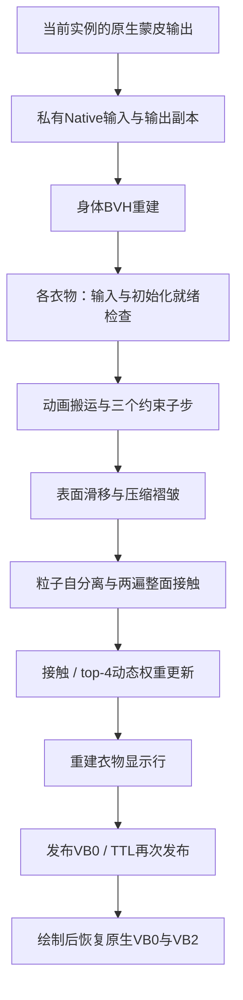

# 拖拽碰撞与上下穿脱：配置、计算流程和检查

## 节点配置

拖拽交互节点的功能开关中：

| 开关 | 生成内容 | 关闭行为 |
|---|---|---|
| 启用碰撞检测 | 普通拉扯的当前帧身体 BVH 与整面位移约束 | 不生成普通碰撞段族 |
| 启用上下拖拽 | 衣物代理、贴身穿脱、连续褶皱、动态接触权重和独立热键 | 不生成穿脱段族，并清理其自有旧资源 |

两项可分别启用。穿脱本身需要身体表面约束，不依赖普通碰撞开关。

1. 使用 ZZMI 合并骨架导出，并将拖拽交互节点接入结果输出的后处理链。
   删除物体注释的后处理应放在本节点之后，选择衣物与碰撞体需要这些注释。
2. 配置目标 DrawIB 和有效拖拽区域。
3. 开启“启用上下拖拽”。可设置“穿脱衣物集合”和“身体碰撞集合”；集合留空时，
   沿用区域的包含物体与碰撞体列表。两者都必须能命中同一合并载体中的实际导出面。
   身体表面必须连续覆盖袜口至最低位置；只选大腿时，应相应提高最低高度比例。
4. 连通的连裤袜共享一个穿脱目标；拓扑分开的袜子分别控制。无关身体网格不参与衣物形变。
5. 导出后默认通过 **Ctrl+Alt+U** 开启穿脱；可在节点设置运行时默认开启与快捷键。
   沿原抓取操作上下拖动，松手保留目标位置；**Ctrl+Alt+Backspace** 恢复原穿着位置。
   F10 后的首次拖动不需要预先手动复位。

脚部目前固定，最低袜口高度由比例控制，不包含完全越过脚部的脱出过程。该实现
目前接入 ZZMI 合并骨架路线；EFMI 不生成这套运行时。无法识别开口、骨架、布局或
同组件身体时会明确报错，请先修正选择或导出布局。

## 手感参数

| 参数 | 默认值 | 调整效果 |
|---|---:|---|
| 穿脱灵敏度 | 2.0 | 越大，同样下拉量需要的鼠标距离越短 |
| 拉伸柔度 | 0.00003 | 越小越难拉长 |
| 弯曲柔度 | 0.0008 | 越小越有支撑 |
| 速度保留率 | 0.85 | 越小阻尼越强 |
| 抗折叠支撑 | 0.55 | 越大越不容易塌成一团 |
| 褶皱高度 | 0.012 | 越大褶皱越突出，使用模型局部单位 |
| 褶皱间距 | 0.075 | 材料长度比例，越小越密 |
| 有序收拢强度 | 0.8 | 越大越接近有序的纵向材料分布 |
| 最低袜口高度比例 | 0.22 | 相对于原衣物的脚部至开口高度 |
| 物理代理点预算 | 2450 | 超出时自动简化代理，显示网格保留原顶点 |

“衣物向上轴”默认从长轴估计。横放或特殊朝向的模型可明确指定导出坐标方向。
灵敏度与材料硬度分别控制，避免为减少鼠标行程而破坏褶皱支撑。

## 导出计算


`drag_cloth_geometry.py` 负责纯几何数据。每件连通衣物都有自己的命中映射和目标，
衣物间不会共享粒子写入。预算之外使用保持拓扑的端点 QEM；显示映射采用三角形
重心坐标，细节偏移跟随局部形变梯度。身体表面归属与相邻面法向连续性限制贴合
搜索，减少一条腿被另一条腿吸引的情况。

`drag_cloth.py` 负责布局检查、静态文件、着色器实例化、资源和调度。骨架组、
出现次计数器、步长、数量、文件路径都从产物推导，没有角色名、固定哈希或固定顶点数。
输出目录为 `res/drag_cloth/<INI与组件标识>/`，清单仅管理此模块拥有的文件。

## 每帧运行



| 着色器 | 职责 |
|---|---|
| `bounds.hlsl` | 从本帧身体三角形构建 BVH 叶块与上层边界 |
| `copy_bind.hlsl`（按需） | 带 base-vertex 前缀时，组装当前帧绑定参考，保留动态形态更新 |
| `select.hlsl` | 用身体采样核对当前骨架与原生蒙皮输入 |
| `exterior.hlsl` / `contacts.hlsl` | 当前外表面与身体原生接触区域 |
| `cloth_nodes.hlsl` | 输入、就绪判定、动画搬运、滑移、整面接触、速度与动态权重 |
| `cloth_groups.hlsl` | 组内着色拉伸/弯曲约束、袜口支撑 |
| `hull.hlsl` | 当前身体与袜口高度平面的截面点 |
| `self.hlsl` | 空间散列与粒子间分离 |
| `apply.hlsl` | 代理显示映射，只改选中衣物的位置/法线/切线 |

生成器在写出所选组件的蒙皮顶点时，按实例槽复制当次使用的骨架矩阵。后到部件
更新共享骨骼时，穿脱仍能用这份快照通过校验。丽娜实测中，这个时序修正解决了
动作时半脱丝袜短暂跳回全穿的问题。

身体和衣物始终使用当前动画的实际几何。动态权重是身体接触三角形重心权重的
top-4 合并，用于下帧随骨骼搬运衣物；不会把整个人物重新蒙皮，也不会把已蒙皮输出
再当作绑定姿态输入。输出普通 VB 与 4 字节标量 UAV 使用同一内存的不同视图。

全穿时的画面使用原始丝袜，因此后台代理也要持续对齐；首个下拉目标重新建立
当前贴合。数据未就绪时保留原生绘制，不能提交错误初始化。这保留了实验中修正的
首次拖动塌前、Alt 后动画异常、TTL 读取旧缓冲、typed/structured 命中格式不一致等防错。

## 普通碰撞检查

普通拉扯沿同一方向移动时，`rzm_drag_collision_surface.hlsl` 检查丝袜面与身体面的
完整投影重叠，计算每张受控面的允许位移比例，再由顶点取相邻面的最小比例。
身体 BVH 每次从当前拖拽前 VB0 重建。旧工程的三角形数设为 0，也不再静默回退到
只约束点的方案。表面输入、输出与边界使用显式引用，最后直接发布经过约束的 VB0。

该算法与穿脱独立：它保护同向普通拉扯的整面移动，不求解自由布料；原模型已有
交叉、碰撞体缺面和非兼容组合位移不属于无穿模保证。穿脱的褶皱是实时压缩驱动的
程序化形变，粒子分离也不等同于完整三角面自碰撞。

普通碰撞的受控面覆盖依据区域权重，不依赖导出时是否已经贴到身体，较松的衣物
也会进入后续整面检测。区域强制关闭的碰撞体不会混入其他启用区域的身体网格。

## 验证入口

```text
python -X utf8 -m unittest tests.test_drag_cloth tests.test_drag_collision_sweep tests.test_drag_feature_switches
```

Windows 下的生成产物测试通过 `tools/check_drag_cloth.py` 解释实际发射的命令、
复制和视图绑定，在 D3D11 执行生成的 HLSL，核对独立袜子、身体行不变及关闭时零调度。
普通碰撞测试包含穿过大面内部、同时覆盖正反面的路径与独立三角形相交检查。
实验游戏验证与生成产物验证应分别记录，不能用着色器编译成功代替游戏绘制链验收。

### 2026-11-07 迁移验收

| 检查 | 结果 |
|---|---|
| 拖拽、整面碰撞、开关、Present 顺序、合并骨架、TTL 与穿脱回归 | 299 项运行完成，16 项跳过，其余通过 |
| EFMI 拖拽与物体注释兼容回归 | 通过 |
| Blender 5.0.1 全插件注册与真实 RNA 属性检查 | 通过；上下拖拽默认关闭，界面属性与图标有效 |
| 生成命令在 D3D11 执行 | 独立袜子、简化代理、额外顶点属性、前缀布局、动态绑定更新、首次初始化与关闭零调度通过 |
| 丽娜实际导出数据在 RTX 4070 回放生成命令 | 2439 个代理点、16398 个身体面；5520 个丝袜显示顶点移动，身体字节不变 |
| 丽娜材质绘制接入 | 25/25 个绘制或复制段接入，包含 TTL 内层重新发布 |
| 丽娜重复导出与开关开→关→开 | 内容稳定；关闭后运行时引用和自有资源清理通过 |
| 当前游戏模组保护 | 37 个已安装文件哈希全部保持一致 |

上述真实数据回放是离线生成产物检查，未将检查目录覆盖进 Mods。新生成产物尚未重新
在游戏中完成操作验收；已有游戏验证对应迁移前的丽娜实验版。
